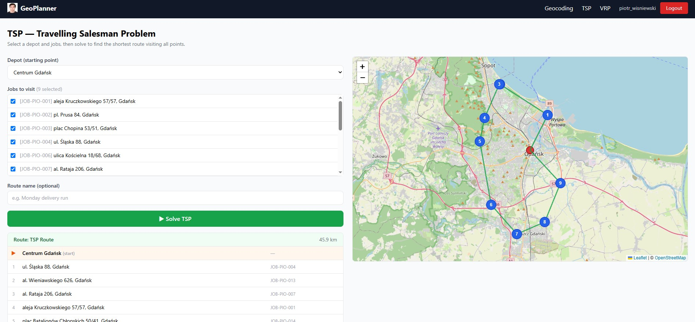
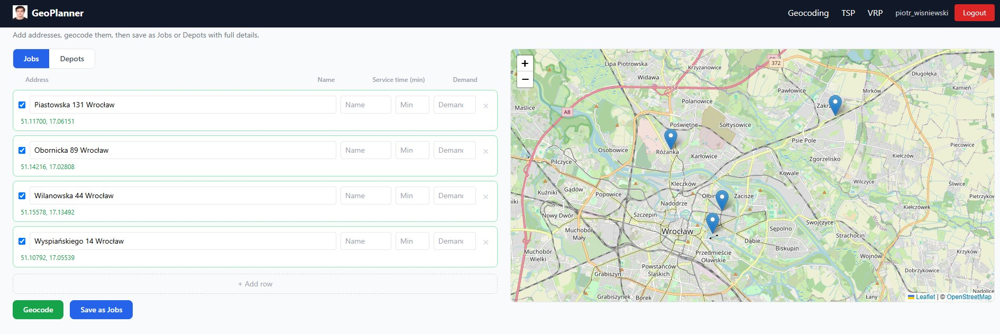
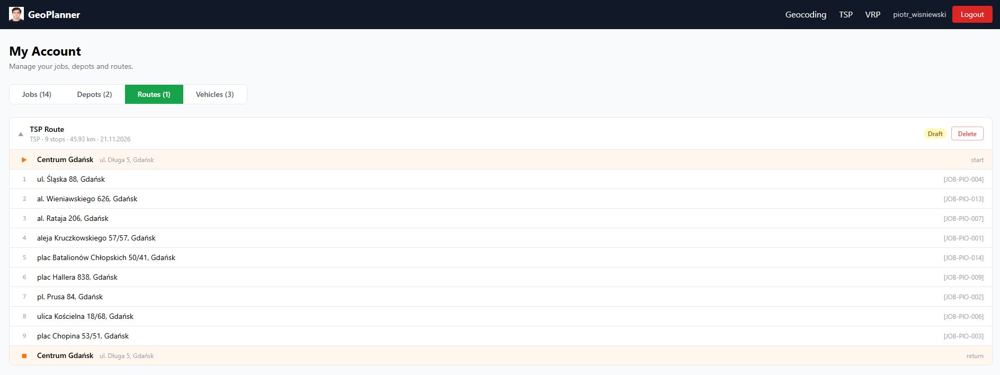
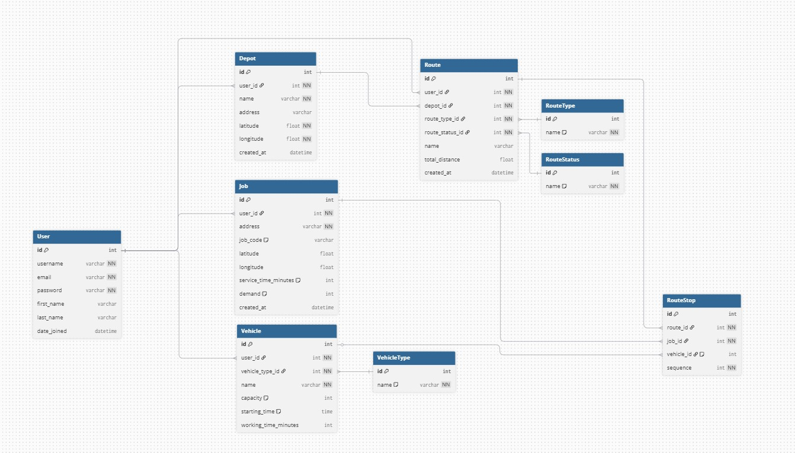

# GeoPlanner – Route Optimisation Web App

🇬🇧 **English** · 🇵🇱 [Wersja polska](README.pl.md)

[](https://github.com/MalickiJacek/geoplanner-route-optimizer/actions/workflows/ci.yml)


Full-stack web application for planning delivery routes. A user imports addresses, geocodes them to coordinates, and the backend computes the optimal visiting order from a depot with **Google OR-Tools** (Travelling Salesman Problem). Results are stored per user and drawn on an interactive map.


*Depot in Gdańsk, 6 selected jobs – OR-Tools returns the visiting order and the total distance.*

## Features

- **Geocoding** – batch conversion of a list of addresses to coordinates via OpenStreetMap Nominatim (no API key needed)
- **Route optimisation (TSP)** – `POST /api/routes/{id}/solve/` builds a distance matrix (Haversine), OR-Tools finds the best order (Path Cheapest Arc + Guided Local Search), stops are saved with their sequence and the total distance
- **Map view** – Leaflet + OpenStreetMap: depot, jobs and the solved route
- **Accounts** – registration, JWT login with automatic token refresh; every user sees only their own depots, jobs, vehicles and routes
- **Fleet management** – vehicles with type, capacity, working time and photo (Pillow)
- **Demo data** – `seed_db` creates 3 users with depots, jobs and vehicles (Faker)
- **Docker** – PostgreSQL + Django + React in three containers, one `docker compose up`

**Roadmap:** VRP for multiple vehicles with capacity constraints (data model ready, UI marked *coming soon*), Celery + Redis for long computations, route history with variant comparison, deployment.

## Screenshots

| Geocoding | Saved routes |
|---|---|
|  |  |
| Addresses → coordinates (Nominatim), preview on the map, save as jobs or depots | Per-user jobs, depots, vehicles and solved routes with their stops |

## Architecture

```
┌──────────────┐   REST + JWT    ┌──────────────────────┐        ┌────────────┐
│ React (Vite) │ ──────────────▶ │ Django REST Framework │ ─────▶ │ PostgreSQL │
│ Leaflet map  │ ◀────────────── │  geoplanner app       │        └────────────┘
└──────────────┘                 │   ├─ algorithms.py ───┼─▶ OR-Tools (TSP)
                                 │   └─ GeocodeView ─────┼─▶ Nominatim (OSM)
                                 └──────────────────────┘
```

### Data model



| Table | Description |
|---|---|
| `Depot` | starting point (e.g. warehouse) |
| `Job` | delivery point / order, reusable across routes |
| `Vehicle` | fleet vehicle with capacity and working time |
| `Route` | a solved route (type, status, total distance) |
| `RouteStop` | ordered stops of a route, optional vehicle assignment |
| `RouteType`, `VehicleType`, `RouteStatus` | dictionaries, filled by a data migration |

## Quick start (Docker)

```bash
git clone https://github.com/MalickiJacek/geoplanner-route-optimizer.git
cd geoplanner-route-optimizer
cp .env.example .env            # set SECRET_KEY and DB_PASSWORD
docker compose up --build
docker compose exec backend python manage.py seed_db     # optional demo data
```

- Frontend: http://localhost:5173
- API: http://localhost:8000/api/
- Admin: http://localhost:8000/admin/ (`docker compose exec backend python manage.py createsuperuser`)

Demo login after `seed_db`: `anna_nowak` / `Test1234!`

More Docker commands (in Polish): [`docs/DOCKER_PL.md`](docs/DOCKER_PL.md)

## Quick start (without Docker)

Without `DB_NAME` in the environment the backend falls back to SQLite.

```bash
# backend
cd backend
python -m venv .venv && source .venv/bin/activate    # Windows: .venv\Scripts\activate
pip install -r requirements.txt
python manage.py migrate
python manage.py seed_db
python manage.py runserver

# frontend (second terminal)
cd frontend
npm install
npm run dev
```

## API

| Method | Endpoint | Description |
|---|---|---|
| POST | `/api/register/` | create account |
| POST | `/api/token/`, `/api/token/refresh/` | JWT login / refresh |
| POST | `/api/geocode/` | `{"addresses": [...]}` → coordinates |
| CRUD | `/api/depots/`, `/api/jobs/`, `/api/vehicles/`, `/api/routes/` | user-scoped resources (`?include_archived=1` for depots/jobs) |
| POST | `/api/routes/{id}/solve/` | `{"job_ids": [...]}` → optimal order, stops and distance |
| GET | `/api/route-types/`, `/api/vehicle-types/`, `/api/route-statuses/` | dictionaries (read-only) |

## Tests

```bash
cd backend
python manage.py test
```

24 tests: models, authentication and per-user data isolation, the `solve` endpoint (ordering, re-solving, validation, access to other users' data) and the algorithm itself – Haversine distance and a check that OR-Tools matches the **brute-force optimum** on a small instance and is never worse than the nearest-neighbour heuristic. CI (GitHub Actions) runs the backend tests and the frontend build on every push.

## Tech stack

**Backend:** Python 3.12 · Django 6 · Django REST Framework · Simple JWT · PostgreSQL · Google OR-Tools · Nominatim (OSM) · Pillow · Faker
**Frontend:** React 18 · Vite · React Router · Axios · Leaflet / React-Leaflet · Tailwind CSS
**DevOps:** Docker · Docker Compose · GitHub Actions · coverage.py

## Project history

The project started in 2024 as three plain HTML/JavaScript pages (geocoding, TSP and VRP on a Leaflet map). That prototype had clear limits: no users (everyone saw the same data), data lost on page refresh, no route history, and a brute-force TSP that became unusable above ~10 points. In 2026 I rebuilt it as a full-stack application – REST API, JWT authentication, PostgreSQL and OR-Tools instead of brute force – as the final project of a Django course. The original prototype is kept in [`docs/legacy-2024-html/`](docs/legacy-2024-html/); presentation slides (in Polish) are in [`docs/presentation/`](docs/presentation/).

## Author

**Jacek Malicki** – GIS developer · [LinkedIn](https://www.linkedin.com/in/jacek-malicki-85b04a27b) · [GitHub](https://github.com/MalickiJacek)

Preparing this public version (monorepo, configuration cleanup, additional tests, CI, README) was done with AI assistance (Claude).

## License

[MIT](LICENSE)
