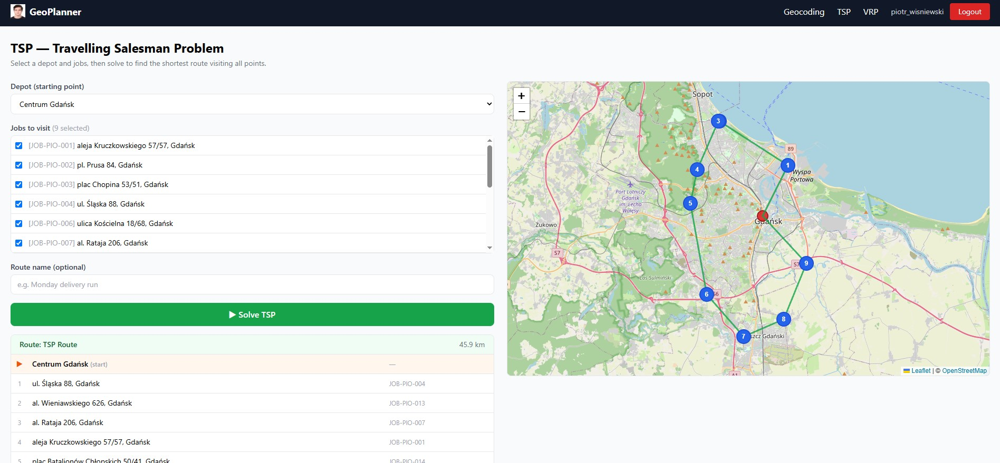
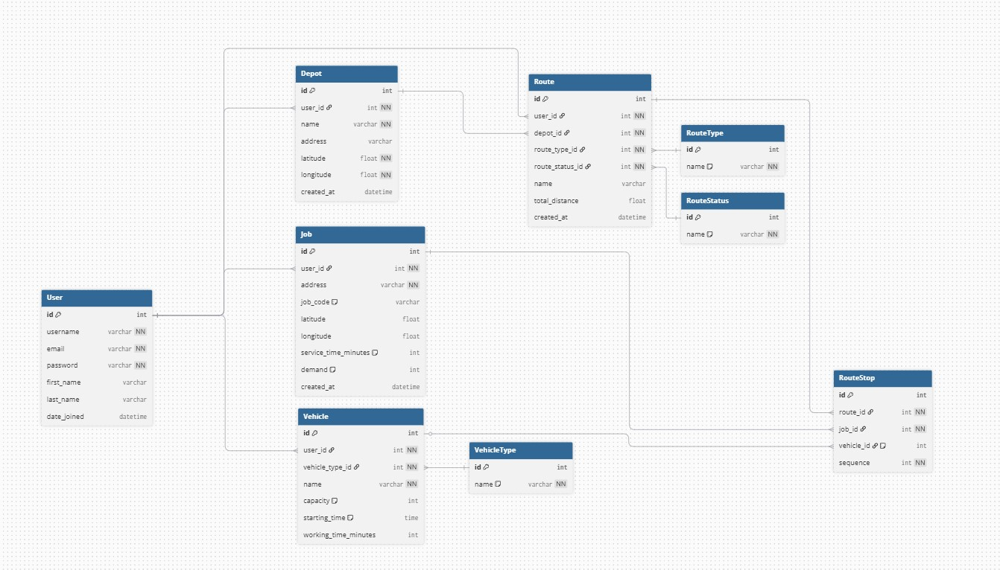

# GeoPlanner – aplikacja do optymalizacji tras

🇬🇧 [English version](README.md) · 🇵🇱 **Polski**

[](https://github.com/MalickiJacek/geoplanner-route-optimizer/actions/workflows/ci.yml)


Aplikacja webowa (full-stack) do planowania tras dostaw. Użytkownik wczytuje adresy, zamienia je na współrzędne (geokodowanie), a backend wyznacza optymalną kolejność odwiedzin z magazynu za pomocą **Google OR-Tools** (problem komiwojażera, TSP). Wyniki są zapisywane osobno dla każdego użytkownika i rysowane na interaktywnej mapie.


*Magazyn w Gdańsku, 6 wybranych zleceń – OR-Tools zwraca kolejność odwiedzin i łączną długość trasy.*

## Funkcje

- **Geokodowanie**: zamiana listy adresów na współrzędne przez OpenStreetMap Nominatim, bez klucza API.
- **Optymalizacja trasy (TSP)**: `POST /api/routes/{id}/solve/` buduje macierz odległości (wzór haversine), OR-Tools wyznacza najlepszą kolejność (Path Cheapest Arc + Guided Local Search), a przystanki zapisują się z numerem kolejnym i łączną długością trasy.
- **Mapa**: Leaflet + OpenStreetMap, z magazynem, punktami i wyznaczoną trasą.
- **Konta**: rejestracja i logowanie JWT z automatycznym odświeżaniem tokenu. Każdy użytkownik widzi tylko swoje magazyny, zlecenia, pojazdy i trasy.
- **Flota**: pojazdy z typem, ładownością, czasem pracy i zdjęciem (Pillow).
- **Dane demo**: `seed_db` tworzy 3 użytkowników z magazynami, zleceniami i pojazdami (Faker).
- **Docker**: PostgreSQL, Django i React w trzech kontenerach, uruchamiane jednym `docker compose up`.

**Plany rozwoju:**
- VRP dla wielu pojazdów z ograniczeniem ładowności (model danych gotowy, w interfejsie oznaczone jako *coming soon*);
- Celery + Redis do długich obliczeń;
- historia tras z porównaniem wariantów;
- wdrożenie na serwer.

## Architektura

```
┌──────────────┐   REST + JWT    ┌──────────────────────┐        ┌────────────┐
│ React (Vite) │ ──────────────▶ │ Django REST Framework │ ─────▶ │ PostgreSQL │
│ mapa Leaflet │ ◀────────────── │  aplikacja geoplanner │        └────────────┘
└──────────────┘                 │   ├─ algorithms.py ───┼─▶ OR-Tools (TSP)
                                 │   └─ GeocodeView ─────┼─▶ Nominatim (OSM)
                                 └──────────────────────┘
```

### Jak działa wyznaczanie trasy

1. Frontend tworzy trasę (`Route`) dla wybranego magazynu i wysyła listę wybranych zleceń.
2. Backend sprawdza, czy zlecenia należą do zalogowanego użytkownika i mają współrzędne.
3. `algorithms.py` liczy macierz odległości między wszystkimi punktami wzorem haversine (odległość po powierzchni Ziemi, w metrach).
4. OR-Tools szuka najkrótszego cyklu: magazyn → wszystkie punkty → magazyn. Najpierw buduje rozwiązanie startowe, potem przez zadany czas (domyślnie 10 s, `TSP_TIME_LIMIT_S`) poprawia je metaheurystyką Guided Local Search.
5. Wynik zapisuje się jako uporządkowane przystanki (`RouteStop`) wraz z łączną długością trasy w km.

W pierwszej wersji projektu używałem algorytmu brute-force, czyli sprawdzania wszystkich kolejności. Dla 10 punktów to już 3,6 mln permutacji, dlatego zastąpiłem go OR-Tools.

### Model danych



| Tabela | Opis |
|---|---|
| `Depot` | punkt startowy (np. magazyn) |
| `Job` | punkt dostawy / zlecenie, wielokrotnego użytku |
| `Vehicle` | pojazd floty z ładownością i czasem pracy |
| `Route` | wyznaczona trasa (typ, status, łączna długość) |
| `RouteStop` | uporządkowane przystanki trasy, opcjonalnie z przypisanym pojazdem |
| `RouteType`, `VehicleType`, `RouteStatus` | słowniki, wypełniane migracją danych |

## Szybki start (Docker)

```bash
git clone https://github.com/MalickiJacek/geoplanner-route-optimizer.git
cd geoplanner-route-optimizer
cp .env.example .env            # ustaw SECRET_KEY i DB_PASSWORD
docker compose up --build
docker compose exec backend python manage.py seed_db     # opcjonalnie: dane demo
```

- Frontend: http://localhost:5173
- API: http://localhost:8000/api/
- Panel admina: http://localhost:8000/admin/ (`docker compose exec backend python manage.py createsuperuser`)

Logowanie demo po `seed_db`: `anna_nowak` / `Test1234!`

Więcej komend Dockera: [`docs/DOCKER_PL.md`](docs/DOCKER_PL.md)

## Szybki start (bez Dockera)

Gdy w środowisku nie ma zmiennej `DB_NAME`, backend korzysta z SQLite.

```bash
# backend
cd backend
python -m venv .venv && source .venv/bin/activate    # Windows: .venv\Scripts\activate
pip install -r requirements.txt
python manage.py migrate
python manage.py seed_db
python manage.py runserver

# frontend (drugi terminal)
cd frontend
npm install
npm run dev
```

## API

| Metoda | Endpoint | Opis |
|---|---|---|
| POST | `/api/register/` | rejestracja |
| POST | `/api/token/`, `/api/token/refresh/` | logowanie / odświeżenie tokenu JWT |
| POST | `/api/geocode/` | `{"addresses": [...]}` → współrzędne |
| CRUD | `/api/depots/`, `/api/jobs/`, `/api/vehicles/`, `/api/routes/` | zasoby danego użytkownika (`?include_archived=1` dla magazynów i zleceń) |
| POST | `/api/routes/{id}/solve/` | `{"job_ids": [...]}` → optymalna kolejność, przystanki i długość trasy |
| GET | `/api/route-types/`, `/api/vehicle-types/`, `/api/route-statuses/` | słowniki (tylko odczyt) |

## Testy

```bash
cd backend
python manage.py test
```

24 testy obejmują:
- modele;
- uwierzytelnianie i izolację danych między użytkownikami;
- endpoint `solve`: kolejność, ponowne wyznaczanie, walidację i brak dostępu do cudzych danych;
- sam algorytm: odległość haversine oraz sprawdzenie, że OR-Tools daje **ten sam wynik co brute-force** na małej instancji i nigdy nie jest gorszy od heurystyki najbliższego sąsiada.

GitHub Actions przy każdym pushu uruchamia testy backendu i build frontendu.

## Technologie

**Backend:** Python 3.12 · Django 6 · Django REST Framework · Simple JWT · PostgreSQL · Google OR-Tools · Nominatim (OSM) · Pillow · Faker
**Frontend:** React 18 · Vite · React Router · Axios · Leaflet / React-Leaflet · Tailwind CSS
**DevOps:** Docker · Docker Compose · GitHub Actions · coverage.py

## Historia projektu

Projekt zaczął się w 2024 roku od trzech stron w czystym HTML/JavaScript (geokodowanie, TSP i VRP na mapie Leaflet). Ten prototyp miał wyraźne ograniczenia:
- nie było użytkowników, więc każdy widział te same dane;
- dane znikały po odświeżeniu strony;
- nie było historii tras;
- algorytm brute-force przestawał działać powyżej ok. 10 punktów.

W 2026 roku przebudowałem go w pełną aplikację z REST API, logowaniem JWT, PostgreSQL i OR-Tools zamiast brute-force. Był to projekt końcowy kursu Django. Pierwotny prototyp jest zachowany w [`docs/legacy-2024-html/`](docs/legacy-2024-html/), a slajdy z prezentacji w [`docs/presentation/`](docs/presentation/).

## Autor

**Jacek Malicki**, programista GIS · [LinkedIn](https://www.linkedin.com/in/jacek-malicki-85b04a27b) · [GitHub](https://github.com/MalickiJacek)

Przygotowanie tej publicznej wersji (monorepo, porządki w konfiguracji, dodatkowe testy, CI, README) odbyło się z pomocą AI (Claude).

## Licencja

[MIT](LICENSE)
